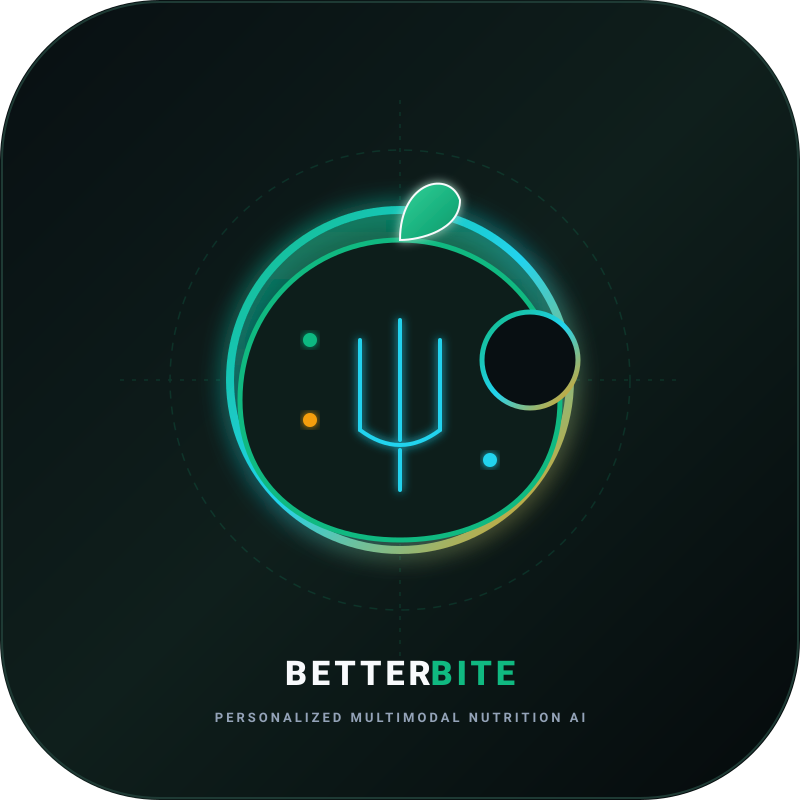
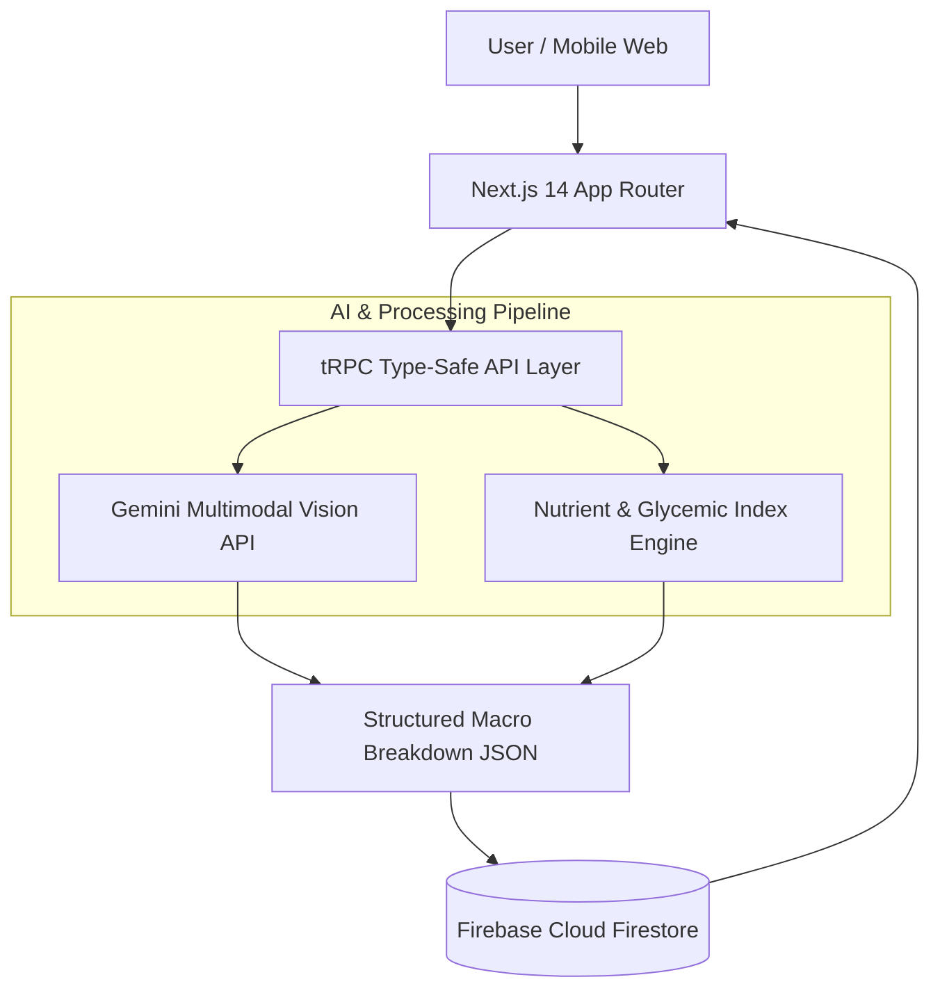

<p align="center">
  
</p>

<h1 align="center">BetterBite</h1>

<p align="center">
  <strong>Personalized Nutrition Intelligence &amp; Meal Photo Analysis with Gemini Multimodal Vision, Next.js, &amp; tRPC.</strong>
</p>

<p align="center">
  
  
  
  
  
  <a href="future.md"></a>
</p>

---

## ⚡ Overview

**BetterBite** bridges culinary enjoyment and metabolic health through cutting-edge multimodal artificial intelligence. By analyzing meal photographs alongside individual biometric constraints (allergies, diabetes management, fitness targets), BetterBite extracts instant macronutrient breakdowns and delivers actionable, personalized nutritional guidance.

---

## 🏗️ System Architecture



---

## 🚀 Features

- **📸 Instant Meal Breakdown:** Upload any food image to receive detailed breakdowns of calories, protein, carbohydrates, fats, and fiber.
- **🎯 Personalized Biometric Grounding:** Considers individual dietary restrictions (vegan, keto, diabetic, celiac) when scoring meals.
- **💬 Conversational Nutrition Coach:** Ask interactive follow-up questions about ingredient substitutions and glycemic management.
- **🧑‍🍳 Smart Pantry Integration:** Suggests healthy recipes utilizing ingredients already present in your kitchen.

---

## 🛠️ Getting Started

### Prerequisites
- Node.js 18+ & pnpm
- Google Cloud Project with Gemini API enabled
- Firebase project for database persistence

### Local Setup
```bash
git clone https://github.com/seeramsujay/betterbite.git
cd betterbite
pnpm install
cp .env.local.example .env.local
```

Configure your `.env.local`:
```env
GOOGLE_API_KEY=your_gemini_api_key
FIREBASE_PROJECT_ID=your_project_id
```

Run the development server:
```bash
pnpm dev
```
Open [http://localhost:3000](http://localhost:3000) in your browser.

---

## 🌐 API Endpoints

- `POST /api/analyze` - Ingests meal photo and biometric context, returning structured nutrient JSON.
- `POST /api/chat` - Interactive conversational nutrition guidance grounded in meal history.
- `POST /api/pantry` - Computes personalized recipes based on pantry inventory.

---

## 🔮 Engineering Roadmap

To explore planned features including 3D LiDAR volumetric food measurement, continuous glucose monitor (CGM) Bluetooth telemetry, and on-device TFLite food segmentation, read [future.md](future.md).

---

## 📄 License

Distributed under the MIT License.
